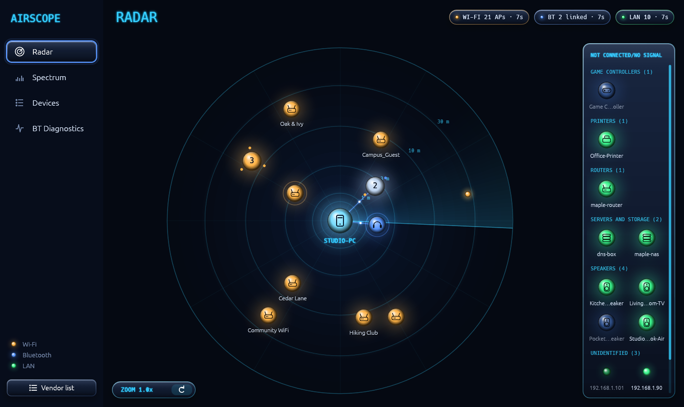
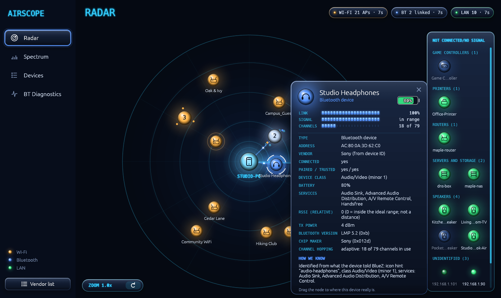
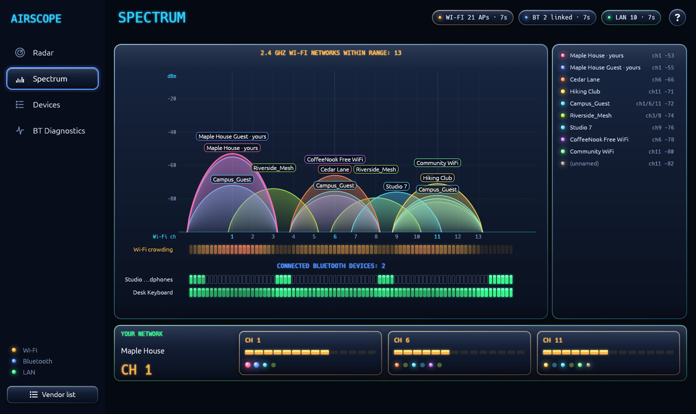
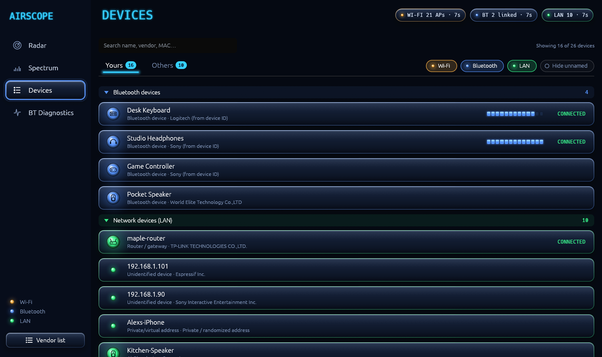
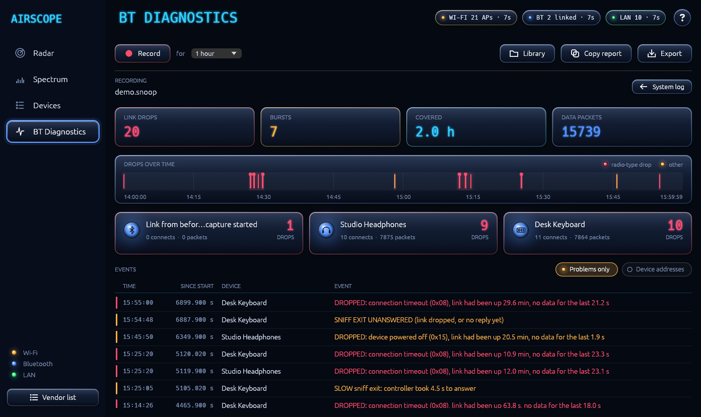
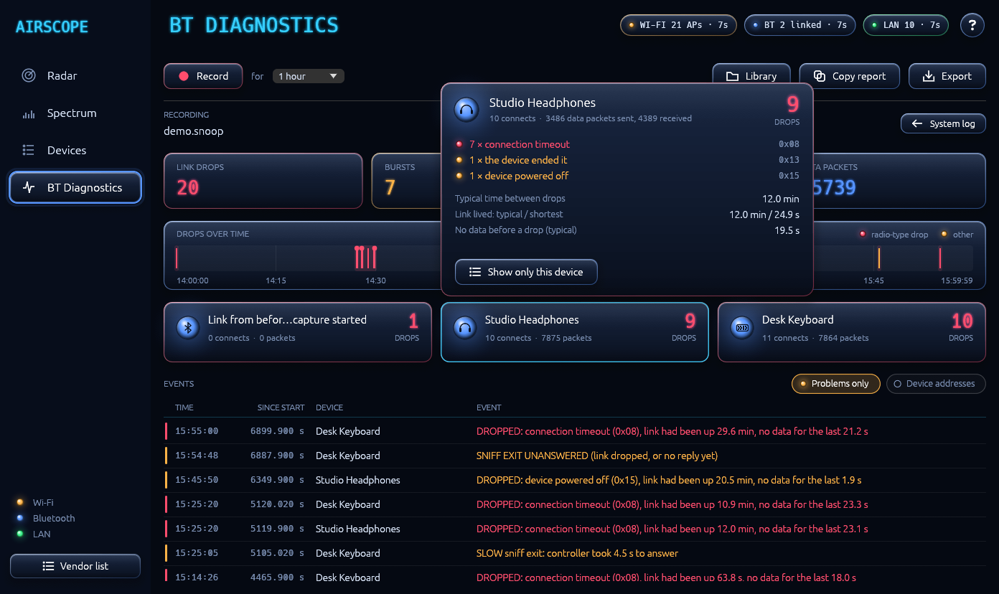
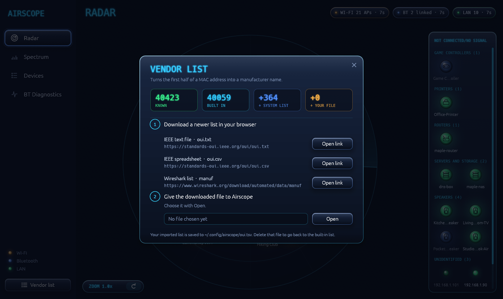
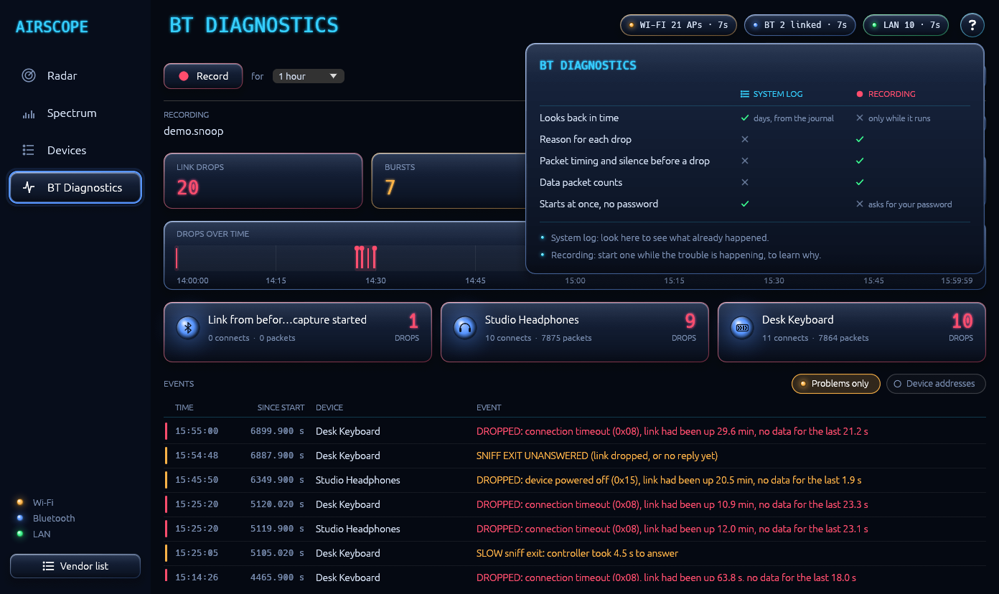
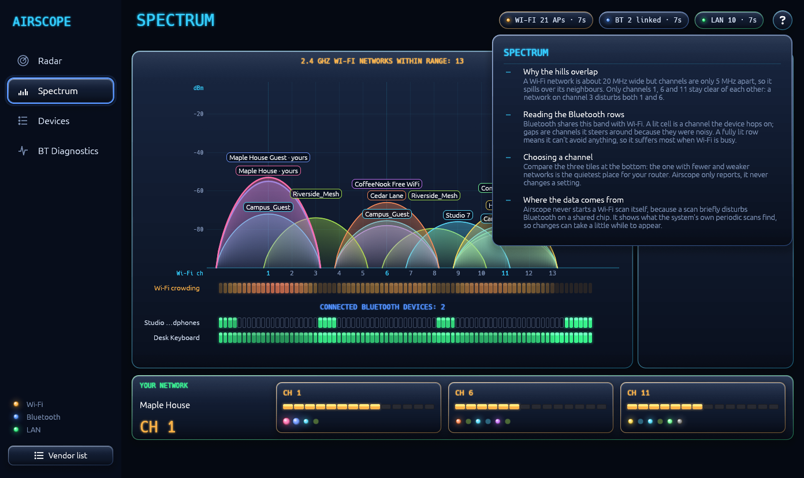

# Airscope

**See the wireless world around your PC as a radar, and find out why your Bluetooth keeps dropping.** Airscope
shows the Wi-Fi networks, Bluetooth devices and LAN devices near you, how crowded the 2.4 GHz band is, which
Bluetooth channels are being steered around the noise, and, from a recording of the Bluetooth traffic, when each
link dropped and why. It is a native Linux app (Rust, egui) that runs on Wayland or X11.

[](https://buymeacoffee.com/teknocat)
&nbsp;If Airscope is useful to you, you can [buy me a coffee](https://buymeacoffee.com/teknocat).



> ### 🤖 AI Disclosure
> **I built Airscope with AI, and every line of the code was written by [Claude Code](https://claude.com/claude-code)**
> (Anthropic's AI coding tool). It wasn't one big prompt, though. I decide what the app does and how it should look and
> feel, check each piece as it's built, test it on my own machine and my own network, and decide what stays. There are
> some unit tests for the parsing code, but what it hasn't had is a review by a human Rust developer, and I'm not one
> myself, so some of the code will probably look like what it is.
> Reviews, bug reports and pull requests are very welcome. More on [how I work with AI](https://github.com/theteknocat/theteknocat/blob/main/AI.md).

## What it does

- **Radar:** every device is an orb. Distance comes from signal strength (rough, and labelled as such); a sweep
  refreshes devices as it passes them. Devices that are close together fold into a group you can click to fan
  out. Drag any device or group to where it really is, and Airscope remembers. Hover an orb for its name and
  signal, click it for everything Airscope knows and *how* it knows.
- **Spectrum:** Wi-Fi networks drawn as hills across the 2.4 GHz channels (true signal strength in dBm), with
  each connected Bluetooth device's channel map underneath, so you can see whether Bluetooth is avoiding the
  busy channels (adaptive frequency hopping) or hopping straight through them. A "Your network" panel shows how
  busy the three clean channels (1, 6 and 11) are and who else is on them.
- **Devices:** a searchable, filterable list of everything seen, split into yours and others, with an info box
  per device.
- **BT Diagnostics:** press **Record** to capture Bluetooth traffic (or open a capture file made with `btmon -w`),
  then see when each link dropped and why. One page for everything: tiles, a strip showing when the drops
  happened, a compact card per device (click one for its details, or to show only that device in the event
  table) and the event table. With nothing recording it shows the **system log**: the Bluetooth problems BlueZ
  and the kernel logged over any time range (since your last recording, this boot, the last few hours or days,
  or a custom range). That has less detail than a recording, but it needs no recording, so you can see what
  happened while you weren't looking. The **Library** button lists your past recordings (analysed in the
  background, and deletable) and opens any capture file. Airscope tells radio-type drops (connection timeouts)
  from normal ones (a device going to sleep), and shows slow answers from the Bluetooth controller. Reports can
  be copied or exported, and the **?** button explains how the system log differs from a recording.
- **Vendor names** from a built-in MAC prefix list that you can update yourself (see below).

| | |
|---|---|
|  |  |
|  |  |
|  |  |
|  |  |

*(All screenshots use the built-in demo data: invented networks, devices and a made-up Bluetooth capture.)*

## Install

**AppImage (any distro from about 2022 on):** download `Airscope-x86_64.AppImage` from the
[Releases](../../releases) page, then:

```text
chmod +x Airscope-x86_64.AppImage
./Airscope-x86_64.AppImage
```

**From source:**

```text
cargo build --release
target/release/airscope
```

### Requirements

| For | Needs |
|---|---|
| The app itself | Wayland or X11, and OpenGL |
| Wi-Fi networks | NetworkManager (Airscope reads its cached scan results over D-Bus) |
| Bluetooth devices | BlueZ (over D-Bus) |
| Bluetooth link details (channel map, link quality) | A Bluetooth adapter and a connected device. These are read with read-only HCI commands, no root needed on the systems I tried |
| Recording Bluetooth traffic (BT Diagnostics) | `btmon` (BlueZ) and polkit's `pkexec`: recording asks for your password through the desktop's own prompt. Opening an existing capture needs neither |
| LAN devices | Nothing extra: ARP table, mDNS and a ping |

Without NetworkManager the Wi-Fi part shows a message and the rest keeps working. There is deliberately no Flatpak,
since the app needs the system D-Bus, raw Bluetooth sockets and the LAN, and I'd have to open the sandbox up for all
of that anyway.

## Privacy and what it touches

- Airscope makes **no internet connections** and sends no telemetry. The vendor list update is manual: you
  download a file yourself and hand it to the app.
- On your local network it **listens and probes**: it reads the ARP table, sends mDNS discovery queries, and
  pings devices the kernel hasn't talked to recently to see if they are still there.
- It asks NetworkManager for a fresh Wi-Fi scan about once a minute, because newer versions only scan in the
  background roughly once a day when your signal is good. A scan briefly disturbs Bluetooth on chips that share an
  antenna with Wi-Fi, which is worth knowing if you're chasing drops.
- It doesn't change any system or adapter settings. The one thing that needs more rights is **Record**, which
  starts `btmon` as root through `pkexec` (your desktop's password prompt) to read the Bluetooth traffic for the
  length you choose. Stop uses `pkexec` again to end the recording early, and nothing else runs privileged.
- It stores a little in `~/.config/airscope/`: dragged device positions, an optional list of your own SSID
  prefixes (`mine.txt`), and an imported vendor list if you made one.
- Recordings are kept in `~/.local/share/airscope/captures/` (one folder each, with a summary and optional
  report). **A capture contains the addresses of nearby Bluetooth devices**, so think before sharing one; delete
  it from the Library when you are done.

## Updating the vendor list

Airscope ships with about 40,000 MAC prefixes. New ones appear over time: click **Vendor list** at the bottom of the sidebar,
download one of the listed files in your browser, and drag it onto the dialog. It understands the IEEE
`oui.txt` and `oui.csv` and Wireshark's `manuf`. To regenerate the built-in list for a release:
`scripts/gen-oui.sh oui.txt`.

## Try it without your own network

```text
AIRSCOPE_DEMO=1 target/release/airscope
```

Demo mode fills the app with invented data and ignores your real hostname and saved positions. It is what the
screenshots above use (`scripts/demo-shots.sh` regenerates them in a headless compositor, with an invented
Bluetooth capture from `scripts/make-demo-capture.py`).

## Honest limitations

- Distances are estimated from signal strength and are rough on purpose; drag devices to where they really are.
- Wi-Fi needs NetworkManager. Other managers (iwd or wpa_supplicant alone) are not supported yet.
- Only 2.4 GHz is drawn on the spectrum; 5 and 6 GHz networks appear on the radar and in the list.
- Tested on one machine (Bazzite / KDE Plasma, Wayland, an Intel AX200). Other hardware may behave differently.
- Only tested with a single Bluetooth adapter. If you use more than one (for example a USB Bluetooth dongle alongside a built-in one), the link details may not cover the extra adapter. Please open an issue if you want that supported.
- Wireless dongles with their own proprietary radios (Logitech Unifying, Steam Controller and similar) are not shown.
- Bluetooth Low Energy devices show up in the lists, but the live view gives them no link details or drop history, because the kernel only lets an unprivileged program see classic Bluetooth connections. A recording from BT Diagnostics still captures their traffic, and everything I use here has been classic Bluetooth, so I haven't tested how much of it reads well for Low Energy.
- BT Diagnostics reports what the capture shows (when and how links ended); it can point at a likely cause but
  it can't prove one. It was built while chasing intermittent drops on one machine, so treat the reasons it
  highlights as hints. Recording captures Bluetooth traffic only.

## Building a release

Releases are built by GitHub Actions when a tag is pushed: bump `version` in `Cargo.toml`, commit, then
`git tag vX.Y.Z && git push --tags`. To build the AppImage locally (needs podman): `packaging/build-appimage.sh`.

## License

[MIT](LICENSE)

The question mark on the help button is from [Font Awesome Free](https://fontawesome.com) (CC BY 4.0).
